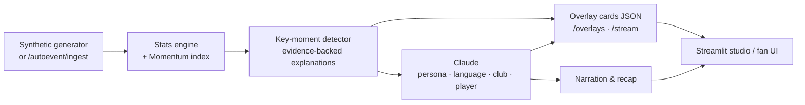

# ⚽ PitchLens: Explainable Match Intelligence for Every Fan

> *Every moment explained. Every fan, their own match.*

PitchLens turns a stream of **synthetic** football events into explainable insight, timed broadcast overlays and personalized narratives, in multiple languages. Built for the Microsoft football match-intelligence hackathon.

Scorelines tell fans *what* happened, not *why it mattered*. PitchLens computes the evidence first (xG swings, pressing traps, momentum shifts, pass difficulty), then has Claude narrate it for the analyst, the casual fan or the one-player follower, constrained to the computed facts so nothing is hallucinated.

> **Data note:** all match events are generated by a seeded simulator. Club and player names (Arsenal vs Chelsea) are used only as labels. No real match data is used or redistributed.

---

## How it maps to the five pipeline stages

| Stage | What PitchLens does | Where |
|---|---|---|
| **a. Ingest** | Seeded synthetic match generator streams ~1,500 football-realistic events (passes, shots, tackles, pressure, possession changes) with timestamps, coordinates, speeds and player IDs. Extensible and reproducible via `seed`. | `generate_match()`, `GET /events`, `POST /match/new` |
| **b. Interpret** | Live stats: possession, territory, pass accuracy, **pass difficulty rating**, xG, PPDA-style pressing, ball and shot speed, player speed and distance. A rolling 5-minute **Momentum & Control index** with a controlled / balanced / chaotic label. | `compute_state()`, `build_momentum()`, `GET /match/state`, `/match/momentum` |
| **c. Explain** | Key-moment detection (goals, big chances, pressing traps, momentum shifts, sprint alerts, distance milestones, difficult passes). Every moment carries a *why it matters* built from computed numbers. | `detect_moments()`, `GET /match/moments` |
| **d. Render** | Timecoded, machine-readable overlay cards (`show_at_s`, `duration_s`, `layout`, `priority`) for a graphics layer, plus a live SSE stream. A Streamlit studio view previews them. | `GET /overlays`, `GET /stream`, `pitchlens_app.py` |
| **e. Personalize** | Analyst / Casual fan / Player Focus modes, favourite-club lens, 7 languages (English, French, Portuguese, Yoruba, Hausa, Igbo, Nigerian Pidgin), Claude-written commentary and full-time recap. | `POST /narrate`, `POST /recap`, `translate_cards()` |

### Brief coverage

- **Real-time match intelligence:** player name tagging, threshold sprint and distance alerts, pass distance, accuracy and difficulty, ball and shot speed.
- **Narrative generation:** commentary, milestones, player pulse cards, automated recap.
- **Explainability:** control vs chaos, tactical pressure (pressing traps), game rhythm (turnover rate), momentum shifts.
- **Data innovation:** seedable generator with a shared event schema.
- **Multi-language storytelling:** Claude renders overlays, commentary and recaps in 7 languages.
- **Auto-eventing:** a documented hook, `POST /autoevent/ingest`, accepts detections from a video model (pass and speed events) and re-runs the whole pipeline. *No video model is shipped; this is the integration point.*

---

## Extras

### Player Focus alerts
Pick **Player focus** and a player. PitchLens follows that player all match: a live summary strip (passes and accuracy, avg pass difficulty, shots/xG, tackles, distance, top speed) plus **threshold alerts**: sprint speed (default 30 km/h, adjustable), distance milestones (default every 2 km), non-goal shots and difficult passes. Goals and big chances arrive as normal key moments. API: `GET /player/focus?player=&minute=&speed_kmh=&distance_step_km=`; alerts also flow through `/overlays` and `/stream` with `persona=player_focus`.

### Azure AI Speech voice-over
`POST /voiceover` turns any narration, overlay card or recap into MP3 using Azure neural voices (English, French, Portuguese, and a Nigerian-accented voice for Pidgin). Set `AZURE_SPEECH_KEY` and `AZURE_SPEECH_REGION` in `.env`. `GET /voiceover/voices?locale=en-NG` lists the voices in your region so you can override with `AZURE_VOICE_<LANG>`. I could not confirm Azure neural voices for Yoruba, Hausa or Igbo, so for those the UI falls back to the browser's built-in voice (quality and availability depend on the device).

### Auto-eventing hook (no model shipped)
`POST /autoevent/tracking` accepts frames from a video model (ball position, current possession holder, optional player positions) and **derives pass and speed metrics automatically** with `tracking_to_events()`: a holder change with ball movement is a pass (distance, ball speed = distance / flight time, success if same team, otherwise a turnover), and position deltas give player speed. Set `commit: true` to feed the events into the live match and re-run interpret and explain; `POST /match/new?empty=true` starts an empty match for a live feed. A real detector (for example YOLO + ByteTrack + pitch homography + ball-possession association) only has to emit the documented `Frame` objects.

`POST /autoevent/simulate` and the **Auto-eventing** tab demo the plumbing without a model: frames are fabricated from the synthetic truth plus tracking noise, then scored (on the default match with 0.4 units of noise: roughly 92% pass recall, 97% precision, ~2 km/h ball-speed error). These numbers measure the converter on simulated input, not a real vision model.

## Architecture



## Quick start

```bash
git clone https://github.com/tayostats/pitchlens && cd pitchlens
python -m venv .venv && source .venv/bin/activate     # Windows: .venv\Scripts\activate
pip install -r requirements.txt

cp .env.example .env        # then paste your key into .env  (Windows: copy .env.example .env)

uvicorn pitchlens_api:app --port 8000      # terminal 1
streamlit run pitchlens_app.py             # terminal 2
```

Check `http://localhost:8000/health`. `"claude_enabled": true` means the key was picked up. Without a key the app still runs using template text in English, but multi-language output needs Claude.

Optional: `ANTHROPIC_MODEL` overrides the default model (`claude-sonnet-5-5`). Use `POST /match/new?seed=21` for a different match.

## API at a glance

| Endpoint | Purpose |
|---|---|
| `GET /events` | Raw ingest feed |
| `GET /match/state?minute=` | Live stats up to a minute |
| `GET /match/momentum` | Momentum & control series |
| `GET /match/moments?minute=` | Key moments with evidence |
| `GET /overlays?minute=&persona=&language=&favorite_team=&focus_player=` | Overlay cards |
| `GET /stream?speed=60` | Server-Sent Events, overlays in accelerated real time |
| `POST /narrate` | Persona and language commentary for one moment |
| `POST /recap` | Automated match recap |
| `POST /autoevent/tracking` | Video-model tracking frames in, pass and speed events out |
| `POST /autoevent/simulate` | Demo and scoring of the hook with simulated frames |
| `POST /autoevent/ingest` | Already-structured detections in |
| `GET /player/focus` | Player Focus summary and threshold alerts |
| `POST /voiceover` | Azure AI Speech MP3 for any text |
| `POST /match/new?seed=` | Generate a new synthetic match |

## Tech stack

Python · FastAPI · Streamlit · Altair · Anthropic Claude API · Azure AI Speech (optional voice-over) · pure-Python analytics engine

## Repo layout

```
pitchlens_api.py        # backend: generator, stats, moments, overlays, Claude, endpoints
pitchlens_app.py        # Streamlit studio + fan UI
.streamlit/config.toml  # dark theme
requirements.txt
.env.example
```

## Limitations and next steps

- Narration quality in Yoruba, Hausa and Igbo should be reviewed by native speakers before production use.
- Auto-eventing from video is an integration hook, not a trained model; its accuracy numbers come from simulated input.
- Azure voices for Yoruba, Hausa and Igbo are not configured (browser voice fallback).
- The momentum index weights are hand-tuned, with a clear path to learning them from data.